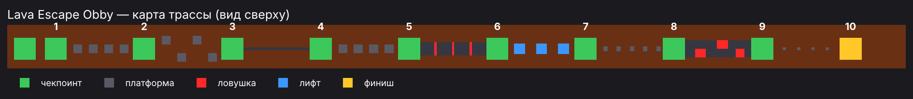

# Lava Escape Obby — прототип для Roblox

Obby-паркур над лавой: 10 уровней с нарастающей сложностью, чекпоинты с сохранением прогресса, ловушки, лифты и монетизация. Прототип собран методом вайбкодинга — с нейросетью, от идеи до готового файла карты за одно утро.



## Что внутри

| Механика | Как реализовано |
| --- | --- |
| 10 уровней | Прыжки, зигзаг, узкая балка, лестница, барьеры, лифты, мелкие плитки, ловушки на дорожке, финальные прыжки |
| Чекпоинты | Засчитываются строго по порядку (нельзя перепрыгнуть уровень), респавн на последнем пройденном |
| Сохранение прогресса | `DataStoreService`: уровень сохраняется при выходе и при остановке сервера (`BindToClose`), загружается при входе |
| Лидерборд | `leaderstats` → `Stage` виден в списке игроков |
| Ловушки | Касание красного блока или лавы — смерть и респавн на чекпоинте |
| Лифты | `TweenService`, бесконечное движение вверх-вниз; смещение и скорость задаются атрибутами `Offset` и `Time` |
| Монетизация | Gamepass «Speed Boost» (скорость 16 → 26) и Developer Product «Skip Stage» с обработкой через `ProcessReceipt` |
| UI магазина | Кнопки покупки создаются кодом и скрыты, пока не заданы ID товаров |

## Структура

```
place/LavaObby.rbxlx                          — готовая карта со всеми объектами и скриптами
src/ServerScriptService/GameServer.server.lua — серверная логика: чекпоинты, сохранения, ловушки, лифты, покупки
src/StarterPlayerScripts/ShopGui.client.lua   — клиентские кнопки магазина
tools/build_place.py                          — генератор карты: трасса описана в коде и собирается в .rbxlx
```

Карта не нарисована вручную в Studio, а сгенерирована скриптом `tools/build_place.py`. Уровни можно менять в коде и пересобирать файл за секунду:

```bash
cd tools && python3 build_place.py
```

## Как запустить

1. Открыть `place/LavaObby.rbxlx` в Roblox Studio и нажать **Play**.
2. Для покупок: создать в Creator Hub Gamepass и Developer Product, вписать их ID в `SPEED_PASS_ID` и `SKIP_PRODUCT_ID` в обоих скриптах.
3. Для сохранений в Studio: **Game Settings → Security → Enable Studio Access to API Services**.

## Статус

Прототип не опубликован: Roblox заблокирован в России, и Roblox Studio не входит в аккаунт даже через VPN. Поэтому выкладываю код и файл карты — их можно открыть и проверить в Studio.

## Что дальше

- Поворотные и исчезающие платформы, таймер прохождения
- Глобальный лидерборд по времени (`OrderedDataStore`)
- Скины-награды за прохождение и ежедневный бонус для удержания (D1/D7)
- Сезонная версия трассы для апдейтов
